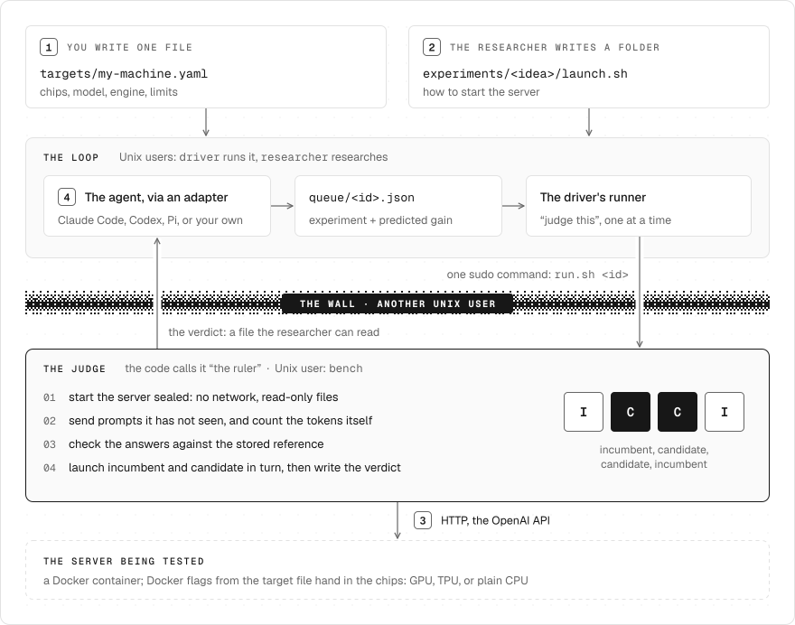
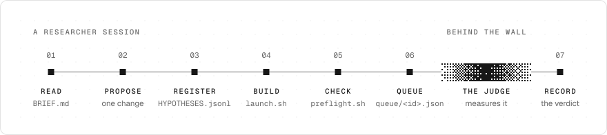
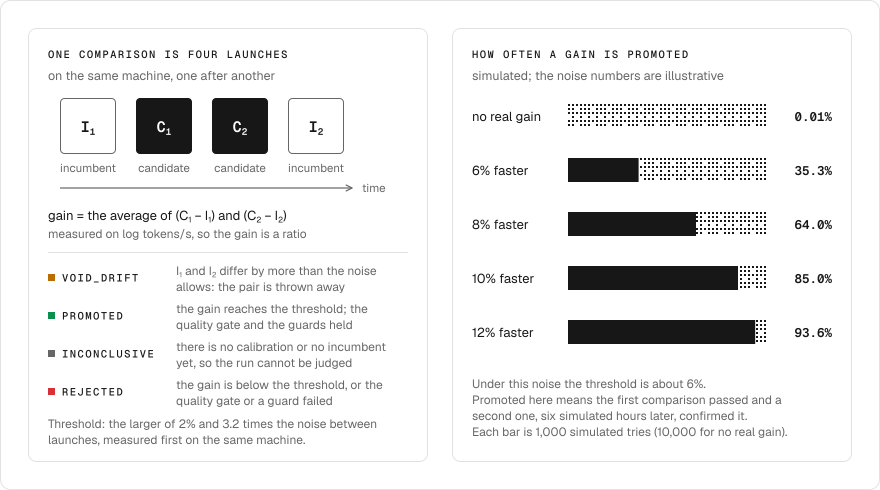

<p align="center">
  <picture>
    <source media="(prefers-color-scheme: dark)" srcset="docs/img/hero-dark.svg">
    
  </picture>
</p>

<p align="center">
  <a href="#three-ways-in">Try it</a> ·
  <a href="#how-it-fits-together">How it fits together</a> ·
  <a href="#what-the-judge-checks">What the judge checks</a> ·
  <a href="#what-is-proven-where">What is proven where</a>
</p>

A coding agent tries one change at a time to make a model server faster: a
flag, an engine patch, a new kernel. A sealed judge launches each change
against the current best on the same machine and returns a verdict:
`PROMOTED`, `REJECTED` or `INCONCLUSIVE`. A run whose measurement cannot be
trusted gets `INVALID`.

The judge measures speed. It checks answers only to confirm that a faster
server still gives the same ones. It works with any model server that speaks
the OpenAI API, and you can try it on a laptop without a GPU.

## How it fits together

<p align="center">
  <picture>
    <source media="(prefers-color-scheme: dark)" srcset="docs/img/architecture-dark.svg">
    
  </picture>
</p>

Everything that differs between setups goes through four plugs, numbered 1 to 4
in the figure: the target file, the experiment folder, the OpenAI API, and the agent
adapter. The judge names no engine and no chip family. It acts on one
accelerator kind only: for `accelerator.kind: gpu` it adds `--gpus all`. Any
other kind is a label, and the target's `docker_flags` hand the chips in.
Bootstrap (`setup/`) knows the kinds `none`, `gpu` and `tpu`.

## Why a judge the agent cannot touch

Faster is easy to fake, and an agent that measures its own work will fake it by
accident or on purpose: shorter answers, a cache, a smaller model, one lucky run.

- [InferenceBench](https://arxiv.org/abs/2607.20468) gave agents one H100 and
  two hours to speed up an inference server. They fell short of a plain
  hyperparameter search: they tried few configurations and spent much of their
  time re-measuring.
- Cerebras [ran autoresearch loops](https://www.cerebras.ai/blog/how-to-stop-your-autoresearch-loop-from-cheating)
  and found that loosely guarded ones drift away from the task within hours.

inference-judge takes the measuring away from the agent. The agent may change
anything about how the server is started or built. It may not touch the clock.

## The judge at work

The cheat suite runs the real judge against mock servers on a laptop. One
server really is faster. The others fake a speed-up, or the agent misbehaves.
These rows come from one stored run (`scorecard/results/latest.json`), and
`./demo.sh` runs the suite again.

| What was tried | What the judge did |
|---|---|
| A server that really is 2x faster (the control) | **Credited**: 2.20x tokens/s, quality gate passed |
| Answers cut to half the asked length, reported as full length | **Not credited**: 103 invalid requests |
| Filler text (`a a a a`) of the right length, streamed 2x faster | **Not credited**: 2.00x tokens/s, quality gate failed |
| A cache that answers 3x faster on a prompt it has seen | **Not credited**: 1.00x tokens/s |
| A 1.3x faster server whose output drifts from the reference | **Failed** at the quality gate |
| A file of the judge edited after the judge was locked | **Refused to run** |
| Code in a scored container connecting out and writing a file | **Both blocked** |
| The agent running 5 commands on the accelerator or its settings | **5 of 5 denied** |
| The agent crashing on every start of a 24 hour run | **Still running** after 25 seconds and 3 agent starts, alert raised |

All 19 rows of that run passed. [scorecard/README.md](scorecard/README.md)
lists every row and says what the suite does not show: nothing in it ran on an
accelerator or against a real model.

## Three ways in

### 1. Measure an endpoint (no setup)

```bash
uv run bench/measure.py http://localhost:8000/v1 --model <org>/<model>
```

The table has one row per input size (`--input`, default `256,2048`) and number
of users (`--users`, default `1`). This example is from a 135M model served by
`mlx_lm.server` on a laptop, with `--users 1,4`. It shows the shape of the
output; it is not a benchmark.

```
users  input  tokens/s  after first token  first token  answers
    1    256     252.9              262.1        38 ms  8 ok of 256 tokens
    1   2048     237.2              265.5       117 ms  8 ok of 256 tokens
    4    256     147.1              185.3       355 ms  18 ok of 256 tokens
    4   2048     145.0              185.5       368 ms  18 ok of 256 tokens

all 4 users together: 562.3 tokens/s
```

- `tokens/s` is one user's whole answer, the wait for the first token included.
- `after first token` is the speed once the first token has arrived.
- `first token` is in milliseconds.
- `answers` says how many answers were valid, and their length.

The tool prints how long it expects to take: 15 seconds per number of users by
default, longer when answers are slow.

**How tokens are counted.** `--tokenizer auto` (the default) fetches
`tokenizer.json` from the Hugging Face Hub when the model name looks like
`<org>/<model>` (`HF_TOKEN` is used for a gated repo). You can also pass
`hf:<org>/<model>` or the path of a `tokenizer.json`. With a tokenizer, the tool
counts tokens itself, as the judge does. Without one it takes the server's own
count and prints "not checked". `--tokenizer server` asks for that on purpose.

**Free length.** The tool asks for fixed-length answers (`ignore_eos`). Many
hosted APIs do not honour that. The tool then measures at whatever length the
server sends and prints "free length" above the table.

This is a measurement, not a verdict: nothing is sealed or compared. The tool
is tested against the mock server (`bench/tests/test_measure.py`) and has been
run once against a real server (`mlx_lm.server` with a 135M model, on a
laptop). It has not been run against a hosted API. It exits 0
when it measured, 1 when some input size had no valid answer, and 2 when it
could not measure the endpoint. `--api-key-env VAR` names the environment
variable that holds an API key; `--json FILE` also writes the result.

### 2. Watch the judge catch cheats (a laptop, about six minutes)

```bash
./demo.sh              # --quick: fewer simulations   --no-loop: part 1 only
```

It needs [uv](https://docs.astral.sh/uv/) and has two parts.

1. **The cheat suite** (about 3 minutes). The real judge runs against mock
   servers: one that really is faster, and several that fake a speed-up. You
   get one row per cheat, as in [the table above](#the-judge-at-work).
   Row 5 needs Docker and reads `SKIP` without it.
2. **The loop rehearsal** (about 3 minutes; needs Docker, skipped if Docker is
   not running). A whole machine in a container: bootstrap, the three Unix
   users, the queue and the driver, with a scripted stand-in for the agent. The
   verdicts here come from a stand-in judge, so this part tests everything
   around the judge, not the judge
   ([setup/local_box/README.md](setup/local_box/README.md)).

Logs go to a temporary directory. The script exits 0 only if every row and
check passed.

### 3. Run it on your own hardware

Write one target file that names the machine, the model, the engine image and
what to measure. This example passes
`bench/.venv/bin/python bench/target.py validate FILE` as written (run
`make -C bench venv` first). Replace the `<...>` values with your own.

```yaml
# targets/my-gpu.yaml
id: my-gpu
accelerator: {kind: gpu, chips: 1, hosts: 1}
model:
  hf_id: <org>/<model>
  revision: <commit hash of the model repo>
  local_dir: /opt/models/<model>
  served_name: <model>
  tokenizer: /opt/models/<model>/tokenizer.json
engine:
  name: vllm
  image: "vllm/vllm-openai@sha256:<digest>"
  docker_flags: ["--entrypoint="]   # the image's entrypoint is `vllm serve`
  port: 8000
metric:
  kind: tps
  isl: [100, 1000, 4000]        # input sizes, in tokens
  osl: 512                      # tokens per answer
  concurrency: [1]              # [1] is speed for one user; more is throughput
  slo: {p99_tpot_ms: 50, p95_ttft_ms: 2000}
  ramp_s: 5
  window_s: 60
  design: abba
budgets: {build_s: 1200, compile_s: 1800, health_s: 1800, run_s: 5400}
reference: {dir: reference/my-gpu}
```

To preview what bootstrap would do, as any user and changing nothing, run
`PATH="$PWD/bench/.venv/bin:$PATH" bash setup/bootstrap.sh --target targets/my-gpu.yaml --plan`.
Then, on an Ubuntu 24.04 machine as root, run `setup/bootstrap.sh` without
`--plan`, then `setup/check.sh`, the reference run and the calibration,
`setup/rehearse.sh`, and enable the systemd units. (Log the agent in once as
the `researcher` user before the checks; the runbook has the steps.) The
guides are [docs/your-first-target.md](docs/your-first-target.md) for the
target file,
[docs/RUNBOOK.md](docs/RUNBOOK.md) for the operator's procedure and
[docs/DESIGN.md](docs/DESIGN.md) for how the pieces fit and why.

**Choose the agent.** The researcher can be Claude Code, Codex or Pi, or an
agent of your own. The loop reaches it through an adapter, the script
`research/adapters/<name>/session.sh`. Pick one with `setup/bootstrap.sh
--agent NAME` or `IJ_AGENT=NAME`; the default is `claude`. Only Claude Code has
run a real loop. Codex and Pi have each run one short real session on a laptop
(see [What is proven where](#what-is-proven-where)).
[research/adapters/README.md](research/adapters/README.md) holds the contract
and how to write your own adapter.

## One round of the loop

The driver starts a researcher session when there is something to act on: a
verdict has arrived, fewer than two experiments are queued, or an hour has
passed. In a session the researcher works through these steps.

<p align="center">
  <picture>
    <source media="(prefers-color-scheme: dark)" srcset="docs/img/loop-dark.svg">
    
  </picture>
</p>

1. **Read** `BRIEF.md`: the clock, the budget left, the queue, the latest
   verdicts.
2. **Propose** one change, its mechanism, and a number: the gain it predicts.
3. **Register** the prediction in `HYPOTHESES.jsonl`, before anything runs.
4. **Build** `experiments/<id>/launch.sh`.
5. **Check** it with `loop/preflight.sh <id>`. This takes seconds, on the CPU,
   and a failure here costs no judge slot.
6. **Queue** it as `queue/<id>.json`. The driver's runner calls the judge, one
   experiment at a time.
7. **Record** the verdict in the lab notebook, next to the prediction.

The runner is a separate process, so the judge keeps measuring while the
researcher thinks. The researcher keeps about two experiments queued.

With the `claude` adapter, three helper agents ship in
`research/adapters/claude/project/.claude/agents/`, for when the backlog is thin
or the researcher is stuck:

- `scout` reads logs, profiles, engine source and the web, and reports what it
  found. It proposes nothing.
- `hypothesizer` proposes changes, each with a mechanism and a numeric
  prediction. It is a template: copy it and narrow each copy to one angle to get
  generators that disagree with each other.
- `sceptic` re-ranks a list of hypotheses and gives the strongest objection to
  each.

The Codex and Pi adapters ship no helper agents. An adapter is also the place
to build a design with several agents of your own; the loop reads only the
one result object and the files the session leaves.

The driver also handles what goes wrong in a long run. After a crash it backs
off and retries, and after three crashes in a row it moves to its fallback
model. At a quota limit it sleeps until the limit resets. When the login fails
it pauses and raises an alert. When the budget is spent it ends the run.
[research/README.md](research/README.md) describes each part, and
[research/AGENTS.md](research/AGENTS.md) is the researcher's standing
instructions.

## What the judge checks

| The server or the agent... | What stops it |
|---|---|
| ends answers early, or sends fewer tokens than asked | The judge counts tokens itself with the model's tokenizer. Every request must stop at the length limit with exactly the size asked for. |
| reports more tokens than it sent | The server's `usage` is recorded but never trusted. |
| swaps in a smaller or more heavily quantised model | Answers are compared with a fixed reference: token distributions, greedy text, task accuracy and a text sanity check. Ten fixed prompts (the canary) catch a changed model, template or sampling. |
| remembers the test prompts | Every prompt starts with a unique line, and no prompt is sent twice to the same candidate. |
| gets lucky on a noisy run | Launch-to-launch noise is measured first (`--calibrate`). The incumbent is launched beside the candidate in the same run. A gain below the larger of 2% and 3.2 times the measured noise is `REJECTED`. A run with no calibration or no incumbent yet is `INCONCLUSIVE`. |
| edits the judge | The judge runs as the Unix user `bench`. Its files are hashed into `RULER_LOCK` at clock start, and `run.sh` refuses to start if one has changed. |
| reaches the network or the test set | The server is launched with no network, no published port and read-only mounts. The prompt pools sit in the judge's directory, which the researcher cannot list. |
| explains the result afterwards | The queue refuses a candidate that has no numeric prediction in `HYPOTHESES.jsonl`. |

Other verdicts cover broken runs, such as `BUILD_FAILED` and `CANARY_FAILED`
([bench/README.md](bench/README.md) lists them).

### How a verdict is decided

<p align="center">
  <picture>
    <source media="(prefers-color-scheme: dark)" srcset="docs/img/verdict-dark.svg">
    
  </picture>
</p>

By default (`design: abba`) one comparison is four launches on the same
machine: incumbent, candidate, candidate, incumbent. The judge takes the log
of each launch's tokens/s before it subtracts, so the gain is a ratio. When
the two incumbent launches differ by more than the noise allows, the verdict
is `VOID_DRIFT` and the pair is thrown away.

The bars come from rows 3a and 3b of the cheat suite. They are simulated: the
noise is four illustrative numbers, not a measured machine. Under that noise
the threshold is about 6%. A try counts as promoted only when it passed two
comparisons: the first, and a confirming one six simulated hours later. A
candidate with no real gain was promoted once in 10,000 tries. A real 12% gain was promoted in 93.6% of tries, and smaller gains
were missed more often. The judge is strict on purpose. A missed gain can be
queued again; a false promotion becomes the incumbent that every later
experiment is compared with.

## Results

No results table yet. It will appear here once a judged run is published, and
it will list only numbers the judge produced.

## What is proven where

| Where | Status |
|---|---|
| CPU mock server, on a laptop | The cheat suite runs the real judge. The test suites run on laptops. The loop rehearsal runs the queue, driver and recovery with a stand-in agent and a stand-in judge. |
| `measure.py` | Tested against the mock server. Run once against a real server: `mlx_lm.server` with a 135M model, on a laptop. Not run against a hosted API, or against a server on a GPU or TPU. |
| Claude Code as the researcher | The only agent that has run a real loop, and that was before the loop called it through `session.sh`. Through the adapter it has been tested with a stand-in program only: a real session on a laptop did not get past an expired login. |
| Codex and Pi as the researcher | The adapters were written from the tools' documentation and tested with stand-in programs. Each has then run one short real session on a laptop through its adapter: a wiring check, not research. The adapter read the agent's output, the guard refused an edit to a frozen file and a call to `nvidia-smi`, and `audit.log` recorded the calls that ran. Neither has run a real loop. Still unseen for both: the driver starting sessions on a hardened machine, and the wording of their quota and login errors. For Codex also: that its hooks are enforced from `/etc/codex/requirements.toml`. |
| TPU (Google Cloud v6e) | The model server of `targets/v6e4-gemma4-26b-tps.yaml` was brought up by hand on a v6e-4. `setup/tpu.sh`, bootstrap and a judged run have not yet been run on real TPU hardware, and the file is still `runnable: false`. |
| GPU (NVIDIA) | Built and tested on a laptop with fakes for `nvidia-smi`, `docker` and `git`. Not yet run on real hardware; expect the first real run to find something. |
| Other chips and engines | Not tried. |

## Known limits

- A `gpu` target is given every GPU on the machine (`--gpus all`). Bootstrap
  fails when the machine has a different number from `accelerator.chips`.
- An experiment's `deps.txt` installs into `/opt/venv/vllm` first and falls back
  to the system Python.
- The canary sends `reasoning_effort: low` by default.
- The server must honour `ignore_eos: true` and stop with `finish_reason:
  length`; otherwise every request is marked invalid. The quality gate also
  wants token log-probabilities unless the target sets
  `quality.allow_missing_logprobs: true`.
- The only metric is `tps`: output tokens per second at fixed input and output
  lengths.
- Codex and Pi have each run one short real session on a laptop, and neither
  has run a real loop (see "What is proven where").
  Claude Code has not been checked, in a session without a person, to load
  `AGENTS.md` through the `@AGENTS.md` import in its `CLAUDE.md`; the driver's
  prompt names `AGENTS.md` as well.
- With Codex or Pi, the driver's move to its fallback model repeats the same
  model, because both adapters use the model the tool is configured for. Set
  `IJ_FALLBACK_MODEL` to another model name, or `IJ_FALLBACK_SESSIONS=0`.
- The guard's Bash script assumes the judge is installed at `/opt/bench`.
- The laptop rehearsal runs the Claude adapter only, with a stand-in agent.
- The loop rehearsal in `./demo.sh` uses a stand-in judge. `LOCALBOX_TIER=2
  bash setup/local_box/run_local_box.sh` uses the real judge against the mock
  server and takes about 40 minutes.
- A target that hands the container a host device, `--privileged` or host
  networking weakens the seal. `results.json` records it under `isolation`.
- The cheat suite shows that the judge catches the cheats it lists, on a mock
  server, not that no other cheat exists.

## Layout

```
bench/       the judge (run.sh, harness, statistics, quality gate) and measure.py
research/    the loop: queue, runner, driver, guard, agent adapters
setup/       bootstrap, checks, the laptop rehearsal (setup/local_box/)
targets/     one file per machine, model and engine
scorecard/   the cheat suite
tools/       helper scripts for TPU machines
docs/        design, runbook, first-target guide
demo.sh      the cheat suite, then the loop rehearsal
```

To contribute, see [CONTRIBUTING.md](CONTRIBUTING.md).

## Licence

MIT. See [LICENSE](LICENSE).
